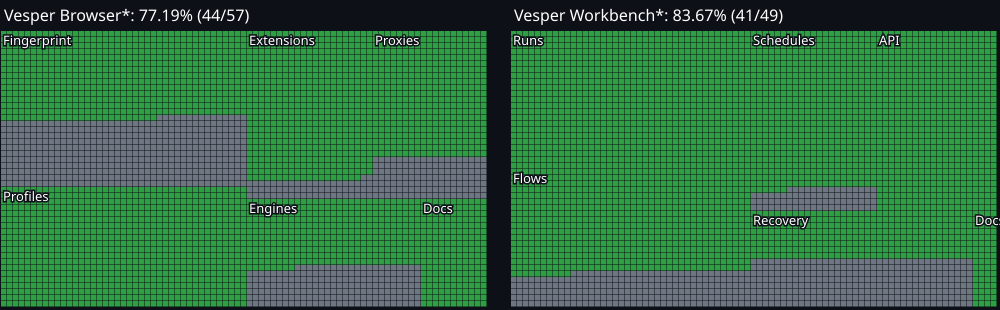

<p align="center"></p>

[**Website**](https://vesper-by-true-utopian.ivory-spoon-5461.chatgpt.site) · [**Project wiki**](https://vesper-by-true-utopian.ivory-spoon-5461.chatgpt.site/wiki/index.html) · [**Handbook source**](docs/wiki/README.md) · [**Previous release guides**](https://vesper-by-true-utopian.ivory-spoon-5461.chatgpt.site/v/0.4.10-0.5.15/wiki/index.html)

# Vesper Browser

**By true-utopian.** An open-source local browser profile manager with an original native Chromium kernel under development. [Vesper Workbench](https://github.com/True-Utopian/vesper-workbench) adds automation as an optional desktop plug-in.

## Status

 



<sub>Green means a named acceptance check passed; grey means pending. Squares visualize proportions, not additional checks. Percentages do not measure vendor parity or detection resistance. See the [evidence-linked checklist](docs/status.md).</sub>

Browser **0.4.13** and signed Workbench **0.5.18** passed local installed qualification on **4 November 2026**. Both pairs passed 20 desktop/documentation/restart checks, 13 API checks including durable notification replay, seven proxy checks, six native identity checks and Python examples. Windows standalone Workbench passed 18 packaged checks; both Linux portable installers executed, and its installed standalone app passed 19 checks in an owned store. [Current qualification and limits](docs/run-event-replay.md#qualified-local-release).

**API Docs → Full handbook** opens the offline local reference and 13-chapter user/developer guide. Both installed pairs passed the exact copied SDK archive-restore walkthrough, including a verified saved artifact, independent import, synthetic cookie recovery and normal restarts. The API reference includes 50 Browser operations and 40 Workbench operations. The public website and project wiki remain available. [Guide acceptance](docs/full-handbook-qualification.md) · [Local reference](docs/localhost-api-docs.md) · [Documentation roadmap](docs/documentation-roadmap.md).

Source checks pass **275 tests on Windows** and **270 on Linux**, with zero failures and two/seven explicit platform or optional skips. The independent Browser checkout passes **102 tests**. Unchanged kernels retain 26 recorded native unit executions; copied runtimes and the new Linux installed native path passed nine cases. Broad personas, WebGL/WebGPU, realtime audio, coherent fonts, media/screen, Firefox/mobile and wider recovery/network qualification remain unfinished. [Native limits](docs/native-kernel-qualification.md) · [Replay acceptance](docs/run-event-replay.md).

Optional Selenium developer tools passed 14 real attachment/lifecycle/archive assertions on each actual installed platform with Selenium 4.41.0 and ChromeDriver 157.0.8103.38. The discovery bridge uses Browser’s guarded connection; it is source tooling, not a bundled driver or a new desktop/kernel build. [Selenium setup, tested subset and limits](docs/selenium-qualification.md).

The local API Docs, public website, project wiki and full user/developer guide milestone are available: **84 of 106** named acceptance checks are locally verified. A passing installed pair does not complete the roadmap. Matching repository CI gates public source publication; applications, runtime binaries, profiles, credentials and raw receipts remain private. Windows standalone NSIS installation, Linux privileged Debian installation and physical GPU qualification remain pending.

## Use Vesper

Local profiles, folders, favorites, tags, notes, proxy routing, cookie tools, templates and reversible trash are available. Profiles are owned by Browser; Workbench uses the authenticated API and saves checksum-verified archives after automation completes. Both apps work with local storage and require no vendor subscription. Proxies are operator supplied.

Windows installers and the signed Workbench add-on are built and tested locally; public downloadable releases are not yet published. Linux portable installers passed real isolated execution with explicit software rendering. Privileged Debian installation and physical GPU qualification remain pending.

## Build from source

Node.js 24 or newer is required. From a clean checkout:

```sh
npm ci
npm run check
npm run desktop:browser
```

Use `npm run package:windows` or `npm run package:linux` to build the desktop app. The light installer obtains a compiled upstream Chromium runtime when needed. The full installer can include a qualified custom kernel with `--full --native-kernel-manifest /path/to/vesper-kernel.json`. Copied-runtime qualification repeats during packaging. The current Windows Browser installer and signed Workbench add-on passed their guarded installed upgrade, native identity and default-store checks. [Bundled engine and safe upgrades](docs/windows-native-installer.md).

**End users do not need the Chromium source checkout.** The large checkout is only for developers compiling the native kernel; ordinary installers contain or obtain compiled browser files. [Native kernel build instructions](native/chromium/README.md).

## Workbench add-on and API

Install a trusted signed Workbench add-on through Browser → Add-ons. Its runs, visual flows and schedules appear inside Browser. The plug-in owns its automation service; it connects to the same Browser profile store. Browser can run independently. [Plug-in contract](docs/workbench-addon.md) · [Browser API](packages/vesper-browser/README.md) · [Workbench source](https://github.com/True-Utopian/vesper-workbench).

This repository contains Browser source, desktop host, original kernel patches and the joint acceptance inventory. Workbench remains separately buildable; its compatibility snapshot of Browser is synchronized from this source until a versioned package release is published. Private profiles, credentials, signing keys, vendor binaries and raw reverse-engineering artifacts are excluded.

## Research

Independent requirements are based on public documentation and bounded read-only observations of locally installed software with REA. The [research ledger](docs/research/feature-ledger.md) records evidence and unknowns. Full proprietary engine internals and competitor parity are not claimed.

MIT license. Vesper Browser and Vesper Workbench by true-utopian.
