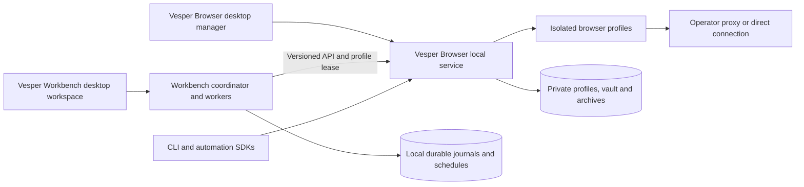

# Vesper product completion plan

By **true-utopian**. Researched against the current source and official upstream documentation on 10 October 2026. This is an implementation and release plan; proposed capabilities are not shipped features.

Implementation update: Browser 0.2 / Workbench 0.3 implement native shells, Windows NSIS installers, Linux Debian artifacts, versioned APIs, durable Browser leases, idempotent admission, SDKs, persistent local coordination, templates and organization, cookies, native environment policies/reports, optional Brave, a visual flow editor, durable schedules and signed offline installer updates. See the [desktop guide](../desktop.md) and [validation](../validation.md). The baseline table below is historical. Original native fingerprint engines, Firefox/mobile, extensions, team accounts, automatic hosted updates/rollback and native Linux qualification remain open.

## Product contract

Ship two independently usable open-source products:

- **Vesper Browser:** desktop profile manager, local browser service, CLI, browser installation, profiles, proxies, persistence and automation connection endpoints.
- **Vesper Workbench:** desktop automation workspace, script and declarative pipeline execution, scheduling, recovery, observations and artifacts. It connects to Browser through a documented public contract.

The default experience must not require a browser vendor account, fingerprint subscription, manually installed Node.js or a separately administered database. The operator supplies proxies when needed; direct connections remain available. An optional remote database or external integration must not be required for ordinary local operation. All primary features need a UI, API, source implementation and measured acceptance result.

The manager is application chrome; browsing sites occurs in separate profile browser processes. Electron's own renderer must not become the profile engine. Closing a desktop window and stopping the browser service are distinct user actions. Only one Browser owner may write a profile store, regardless of how many clients are connected.

## Verified starting point

| Requirement | Current evidence | Gap |
| --- | --- | --- |
| Original source and MIT licensing | Root Workbench source; independent `packages/vesper-browser` project, licence, CLI, UI and public TypeScript client | No independent GitHub release or published package yet |
| Connected applications | `VesperBrowserClient` and `start:connected`; real paired Chromium test | Shared per-run leases are missing; an administrator can interrupt a run from Browser's manager |
| Browser API | Status, profiles, edit, installation check, start/stop, duplicate, CDP endpoint, versions and archive import/export | Version negotiation, full OpenAPI contract, events, deletion, organization, bulk operations and idempotency |
| Workbench API | Runs, installed automations, input challenges, pause/resume/cancel, export retry, screenshots, artifacts, proxy probes and SSE | New-run POST is not idempotent; SSE is not a durable replay log |
| Automation | Trusted Puppeteer workers, JSON flow interpreter, guarded observations, action journals, identity binding and PostgreSQL coordination | Default embedded durable mode, scheduling, richer authoring, additional framework qualification |
| Profiles and proxies | Persistent Chromium directories, encrypted credentials, HTTP/SOCKS5 bridge, archives and crash recovery | Whole-browser routing qualification, templates, tags, retention, updates and more browser settings |
| Installable apps | Web interfaces and Node CLI services work locally | No Electron shell, installer, bundled service runtime or update channel |
| Windows and Linux | Windows local Chromium checks pass; CI configuration includes Windows and Ubuntu compilation/unit tests | No newly qualified Linux Browser runtime or installer; no installers on either platform |
| Fingerprint engine | Standard Chromium with explicit locale/timezone/viewport; a cross-site frame consistency regression fixed | Original native identity/privacy subsystem, rendering surfaces, Firefox and mobile environments |

The [validation record](../validation.md) and [feature ledger](../research/feature-ledger.md) remain authoritative. The previous local suite passed 91 Workbench tests and 3 Browser tests, with one optional external PostgreSQL test skipped. That is not installer or complete feature-parity evidence.

## Desktop packaging decision

Use **Electron with electron-builder** for the first desktop releases, reusing the existing interfaces and TypeScript services. Package Browser and Workbench as separate applications with the same Vesper identity and author attribution. Electron supports packaged Windows and Linux applications; electron-builder offers Windows NSIS and Linux AppImage/deb targets. These are available packaging mechanisms, not binaries already produced by Vesper. [Electron distribution](https://www.electronjs.org/docs/latest/tutorial/application-distribution), [electron-builder targets](https://www.electron.build/docs/targets/).

| Option | Assessment for this repository | Decision |
| --- | --- | --- |
| Electron | Reuses the current web interfaces and Node ecosystem; carries a larger manager runtime | First implementation |
| Tauri | Potentially smaller shell, but adds Rust and a Node sidecar plus system-webview qualification | Reconsider after measuring the Electron release |
| Web interface only | Already usable and useful for headless/API deployments | Keep supported alongside desktop apps |

This preference is an engineering inference from the existing code, not proof that Electron is universally faster. Tauri's Linux build prerequisites include WebKitGTK and other platform libraries; adopting it would add a second desktop stack while our Browser still needs its own Chromium process. [Tauri prerequisites](https://v2.tauri.app/start/prerequisites/).

The desktop shell loads packaged trusted UI with Node integration disabled, context isolation and sandboxing enabled. A narrow preload bridge handles approved desktop actions. Ordinary websites never receive a filesystem or process-execution bridge. The shell authenticates to the private service without putting a token in navigation URLs. This follows Electron's documented renderer isolation requirements. [Electron security guidance](https://www.electronjs.org/docs/latest/tutorial/security).

Bundle a supported Node 24-or-newer service runtime, or prove that the selected Electron service-process runtime meets the same requirements. Do not assume every Electron version embeds our required Node version. Services and browsers are separate from the UI event loop. Headless CLI/API deployments remain usable without Electron.

First distribution targets:

| Platform | Application artifact | Required release qualification |
| --- | --- | --- |
| Windows 11 x64 | Assisted per-user NSIS `.exe` installer; portable development artifact | Clean-user install, native windows, restart, upgrade, uninstall and data retention |
| Ubuntu 24.04 x64 | `.deb` and AppImage | Actual Linux install, sandbox, library dependencies, headed/headless browser and upgrade checks |
| Other Linux distributions and ARM64 | Initially unqualified | Explicit artifact/runtime matrix and native tests before advertising support |

Use native Windows and Linux build workers. Cross-produced artifacts do not prove native execution. A local Linux VM can contribute testing while work stays on this PC; WSL or virtual-display checks must be identified and supplemented with actual desktop-session checks. Current CI configuration is not evidence that future packaging jobs have run.

Application binaries, Node runtime and browser engines need separate version manifests, hashes and retained dependency licences. Ship a full first-install option containing the tested free browser engine, plus a smaller installer with a verified first-run download. Initial downloads and updates need connectivity; installed core workflows can use local fixtures offline. Profile storage belongs outside application installation directories: Windows application-data locations and Linux XDG data/cache locations. Preserve current stores through an explicit migration and backup, rather than moving them silently.

Uninstallation removes the application and leaves profiles by default. Purging profiles is a separate explicit action. Updates drain active work, snapshot schema/state, install a pinned version and perform a compatibility check. Rollback requires a compatible state snapshot; executable rollback alone cannot undo a database or browser-profile migration. Release authenticity and integrity verification are required; Windows publisher signing is a release-owner concern, not a subscription charged to users.

## Public API and shared ownership

Retain existing routes while adding a stable `/api/v1` contract for both services. Use shared schemas and OpenAPI-generated reference documentation, with a typed TypeScript client and a small Python client. The service reports product/API versions and a capabilities object. Unsupported settings produce explicit errors, rather than appearing as supported toggles.

The next contract must include:

1. Profile revisions and conflict detection for edits; documented archive schema versions and import limits.
2. Operation IDs for long installation, launch, export and bulk operations, with progress and cancellation where meaningful.
3. A Browser-owned automation lease: Workbench acquires a profile, and the manager shows its run owner. Manual edits/start/stop require coordinated release or explicit interruption. Lease expiry alone never proves process exit.
4. Idempotency keys for new-run admission and lifecycle operations. Repeating the same request returns the existing operation; a mismatched body fails. This cannot promise exactly-once effects on an external website.
5. Structured error codes and retry classifications, without exposing credentials.
6. Cursor-based event reconciliation. Notifications reference a durable operation/run record; reconnecting clients can recover missed state.
7. Local service discovery and version compatibility. Detect occupied ports and existing owners; never kill an unrelated process to claim a port.
8. Profile-scoped automation connections whose lifetime follows the lease, while preserving an administrator recovery path.

The existing TypeScript client already connects Workbench to Browser. The versioned contract strengthens this relationship; it does not introduce a third product called “Browser Workbench.” The product names remain **Vesper Browser** and **Vesper Workbench**.

## Automation completion

Keep trusted scripts and managed declarative flows as distinct execution modes. Raw code remains useful, while durable recovery is qualified separately. Extend the working observation/journal machinery before adding generic retries or additional concurrency.

| Capability | Implementation direction | Required proof |
| --- | --- | --- |
| Local durable mode | Prototype persistent PGlite behind `SqlDatabase`; one coordinator process owns it | Process-kill recovery, transaction ordering, journal integrity, migration/backup and repeated reopen |
| Optional shared deployment | Keep real PostgreSQL coordination for multiple processes/nodes | Existing PostgreSQL fencing checks plus new Browser-service failure scenarios |
| Scheduling | Durable schedules, bounded queues, restart handling and explicit missed-run policy | Timezone/DST, sleep/wake, clock changes and duplicate-admission tests |
| Authoring | Visual flow editor backed by the existing versioned JSON schema; recorder proposes editable steps | Saved flows execute without hidden editor state; secrets omitted from recordings |
| Observation | Events and targeted DOM conditions, frame-aware targets, guarded readback and state reconciliation | SPA, redirects, iframes, stale elements, downloads and ambiguous states on owned fixtures |
| Reliability | Explicit retry classifications, deadlines, cancellation and reconciliation of uncertain submissions | Interrupt at each lifecycle/action boundary; no blind repeat of irreversible actions |
| Framework access | Puppeteer first; qualified Playwright CDP adapter and version-matched Selenium/ChromeDriver bridge next | Fixture suites per framework/browser/platform/version, with supported features listed |
| Diagnostics | Per-step evidence, screenshots, network failures, traces and bounded artifact retention | Useful failure reconstruction with synthetic secrets absent from public records |
| Capacity | Measured browser admission, fair queues and memory/CPU budgets | Increasing concurrency, proxy failures and crash runs with latency/failure distributions |

PGlite is preferred for the first embedded prototype because the current coordinator uses PostgreSQL SQL and the repository already runs a PGlite flow fixture. It supports persistence and transactions, but exposes a single exclusive database connection. The existing `PgDatabase.holdNodeLock` uses a held PostgreSQL session advisory lock; the test adapter's no-op lock is not a production implementation. A local adapter must have real process ownership and serialized transactions. If persistence, compatibility or resource tests fail, evaluate SQLite behind the same contract and document the SQL migration cost. [PGlite documentation](https://pglite.dev/docs/), [PGlite API](https://pglite.dev/docs/api).

Playwright CDP attachment supports Chromium but has lower fidelity than Playwright's own protocol. A CDP URL alone does not establish support for every Playwright feature. Selenium likewise needs a tested driver/browser combination and connection adapter. Publish the supported subset rather than advertising universal compatibility. [Playwright CDP contract](https://playwright.dev/docs/api/class-browsertype#browser-type-connect-over-cdp), [Selenium Chrome documentation](https://www.selenium.dev/documentation/webdriver/browsers/chrome/).

Pacing and generated pointer movement are existing tools, not evidence of human equivalence or automation invisibility. Optimize throughput using event-driven waits, warm-profile reuse, bounded artifact work and measured admission. Record p50/p95 startup and run latency, peak memory, CPU, export time, sample counts and failure rates. Comparative claims require the same controlled workload on both products.

## Browser feature completion and research

Expand the existing feature ledger into a release-tracked inventory covering templates, folders/tags/notes, bulk operations, reversible deletion, cookie tools, permissions/geolocation, extension management, start pages, browser updates and rollback. The API and UI must expose the same supported capabilities. Backup/restore is qualified separately from cross-PC cookie migration; operating-system-bound encrypted browser data is not universally portable.

Treat coherent fingerprint/privacy controls as a separate engine workstream. Define supported environment combinations and collect request headers, client hints, first-script frame/worker observations, screen, rendering, audio, fonts and media capabilities. Specify original behavior before implementing native changes. Standard browser emulation or an installer does not close this workstream. Retain browser sandboxing and compatibility, and publish measured limits. Firefox and mobile/cloud-phone equivalents require their own engine or device work; they cannot be supplied by merely relabelling a Chromium profile.

Use REA to close narrow questions in the [Kameleo desktop](../research/kameleo-desktop-findings.md), [kernel interaction](../research/kameleo-kernel-boundary.md), and [Multilogin native](../research/multilogin-native-findings.md) reports. Next priorities are the unresolved Multilogin wrapper dispatch, stop acknowledgement versus real exit, settings-to-kernel enforcement, and storage/transport boundaries. Follow static findings with controlled disposable-profile observations. Keep raw/vendor-derived material private and independent product code original.

If original Chromium changes are necessary, maintain a separate patch series against a pinned upstream engine and reproduce builds on each target OS. Chromium's native Windows and Linux build toolchains are substantial and separate from TypeScript application compilation. Track upstream fixes and distribution licences as part of that engine release. [Windows build instructions](https://chromium.googlesource.com/chromium/src/+/main/docs/windows_build_instructions.md), [Linux build instructions](https://chromium.googlesource.com/chromium/src/+/main/docs/linux/build_instructions.md).

Linux qualification includes browser libraries, sandbox/user-namespace policy, GPU/font differences, executable permissions, X11/Wayland and headless execution. Puppeteer documents Linux sandbox and AppArmor constraints; disabling the sandbox is not the product's compatibility strategy. [Puppeteer troubleshooting](https://pptr.dev/troubleshooting).

## Delivery order and completion gates

| Phase | Deliverable | Completion gate |
| --- | --- | --- |
| 1. Stable shared engine | Versioned API, schemas, capabilities, idempotency and Browser-owned run leases | Two clients cannot silently operate one leased profile; crash recovery and contract checks pass |
| 2. Desktop alpha | Two Electron shells, packaged runtime, automatic local connection and first-run browser setup | Clean Windows user installs both apps and completes create → proxy → automate → save → restore without developer tools |
| 3. Linux alpha | Native Linux builds and installers using the same contract | Ubuntu desktop and headless checks pass; installation, browser sandbox and upgrade are qualified |
| 4. Local automation product | Production-qualified embedded coordinator, schedules, diagnostics and flow editor | Durable runs/schedules survive process kills and restarts with no false completion or duplicate submission |
| 5. Browser feature coverage | Profile organization, templates, retention, settings and framework adapters | Each advertised feature has UI/API/docs and platform-specific acceptance evidence |
| 6. Engine and optimization | Original qualified identity/privacy subsystem, engine builds and repeatable benchmarks | Surface consistency and routing tests pass; measured improvements support each public claim |

Desktop alpha can be useful before engine parity. Neither alpha installers nor a large API route count justify the claim “everything is finished.” A competitor release requires a declared feature matrix and supported-platform policy with unresolved areas visible.

Release artifacts must include full source, lockfiles, build scripts, licences/notices, API reference, examples, checksums and a compatibility matrix. The two core applications are independently versioned. Move licensed-vendor compatibility into an optional module so it is absent from the default dependency/runtime path. Repository/package publication and GitHub renaming remain separate actions; this research plan makes no remote changes.

Do not assign a calendar promise before the desktop packaging prototype, embedded database recovery tests and engine research are scoped. Track progress against the gates above and update the existing feature ledger with actual results.
