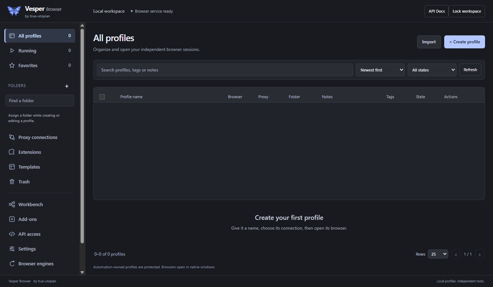

# Install on Windows or Linux

Browser 0.4.13 / Workbench 0.5.18. By **true-utopian**.

Choose the right package and preserve your local store.

## Availability

This handbook targets Browser 0.4.13 and Workbench 0.5.18. Check the matching release qualification record before replacing an existing installation. Public source is available under the MIT license. Installers and native runtime binaries are not publicly distributed yet. There is no public download link to a tested binary release; use your locally built and verified artifacts. Installed desktop apps include their own Node runtime. Ordinary users do not need the Chromium source checkout.

## Windows x64

Use the matching locally generated Browser NSIS .exe and its signed update manifest. Finish active work and use the tray menu’s Quit before replacing files. The accepted local upgrade uses an idle preflight and a fresh independently verified private backup; preserve that backup and its receipt. Browser 0.4.13 and Workbench 0.5.18 are the current local candidates. Their release acceptance requires the matching package and installed-app checks. A standalone Workbench NSIS installation has not been qualified for this pair. Windows Authenticode publisher signing remains unconfigured.

Vesper Browser 0.4.11 on Windows in an isolated empty test store. Open the image for full size.

## Linux x64 portable

The qualified path is a per-user portable installation in an isolated Ubuntu account. Verify the archive against SHA256SUMS, extract it into a new directory, then run sh ./install.sh from that extracted product directory. The installer checks its package manifest before and after copying, creates a versioned directory under ~/.local/share/vesper-apps and preserves an existing launcher. Use --prefix with your own absolute directory to choose another installation location. Do not replace a running version.

## Linux launch and sandbox

Launch the installed vesper-browser executable. The accepted Linux runtime used namespace and seccomp sandboxing. On the GPU-less qualification host, VESPER_GRAPHICS_BACKEND=software selected SwiftShader explicitly; this does not establish physical GPU compatibility or hide a software renderer. Do not disable the sandbox to imitate a passing check. Privileged Debian installation, AppImage and other architectures remain unqualified. The qualification host permits executables only within its approved build workspace. Reproduce that walkthrough with install.sh --prefix pointing to an approved absolute workspace directory. The installer default location is not covered by that host-specific rule. On another host, its namespace policy must permit the installed executable path; ask its administrator to review a sandbox denial rather than using --no-sandbox.

## Where your data lives

Windows normally uses %APPDATA%/true-utopian/vesper. Linux uses $XDG_DATA_HOME/true-utopian/vesper, defaulting to ~/.local/share/true-utopian/vesper. An existing private ~/.vesper/desktop-location.json can select a canonical store. Explicit VESPER_DESKTOP_DATA_DIR overrides it. If a saved location is invalid, resolve it before launching; do not create an empty substitute and assume your profiles were lost. Uninstalling an application keeps its private data folders.

[Wiki contents](README.md) · [Report a correction](https://github.com/True-Utopian/vesper-workbench/issues)
