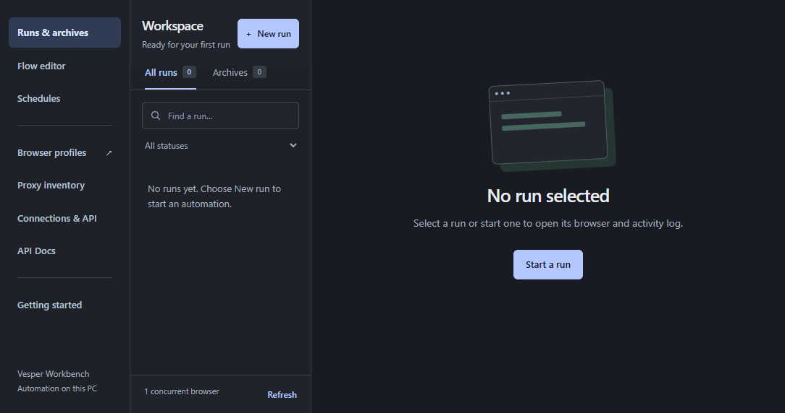

# Your first Browser and Workbench run

Browser 0.4.12 / Workbench 0.5.17. By **true-utopian**.

Follow the local workflow from a profile to a saved archive.

## Open Browser

Launch Vesper Browser and open Profiles. Create a profile with a descriptive name. Choose the engine and supported identity preset deliberately. A stock engine can browse normally; a Vesper native identity policy requires the qualified native kernel. Review the proxy and start pages before opening a profile. A fresh local installation does not contain another operator’s proxy credentials.

## Add Workbench

Open Add-ons → Install Workbench. Select the signed .vesper-plugin.json manifest beside its matching .vplugin.tgz archive for Workbench 0.5.17. Review the reported version and permissions. Browser verifies its pinned signing key, package size and digest. Open Workbench from the new sidebar entry. Close standalone Workbench first: the standalone app and add-on share one Workbench store and cannot own it simultaneously.

Vesper Workbench 0.5.16, captured from the native embedded workspace in an isolated test store. Open the image for full size.

## Run the owned example

In Workbench, select New run → Open and inspect a browser (automation ID inspect). Choose a local page that you own in Page URL and select Chromium for a standard archive walkthrough. Submit once, inspect the browser and wait until the run shows Ready to finish. Running alone does not mean Finish + save is available. Choose Finish + save only when ready. For the bundled sign-in flow, follow its displayed local fixture inputs instead; do not substitute a third-party website for an owned example.

## Verify the result

A completed website action is not sufficient: wait for the run to reach saved. Open its details, inspect the archive metadata and download the artifact. The saved record includes its digest and size. Keep that record with the file. A retained or failed run needs inspection and cleanup; do not delete its profile or repeatedly submit the same website action. The archive transport and run lifecycle guides explain the API equivalents.

## Finish normally

Stop any manually opened profiles and use the tray menu’s Quit when finished. Closing the main window can leave the application in the tray and schedules running. After restart, confirm that the expected profiles, enabled Workbench add-on and saved runs are still visible. Scheduling requires the computer and Workbench service to remain running.

[Wiki contents](README.md) · [Report a correction](https://github.com/True-Utopian/vesper-workbench/issues)
